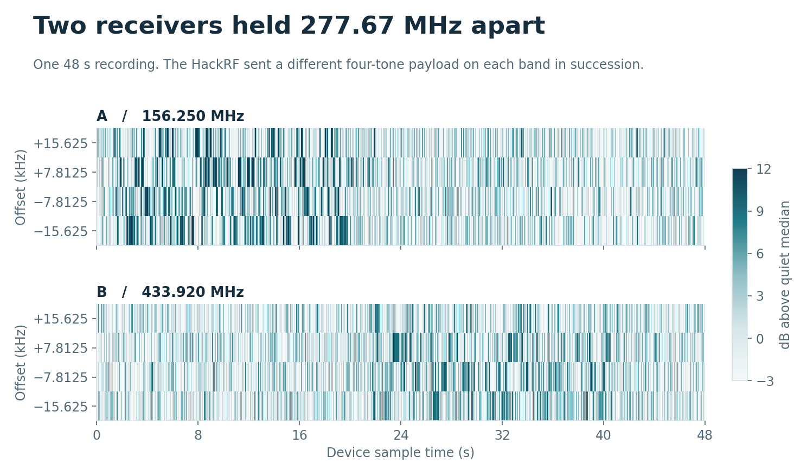
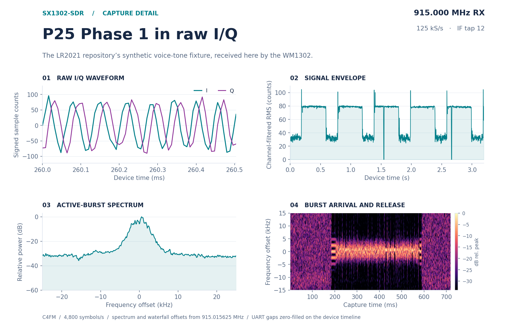

# SX1302-SDR

Raw I/Q from a Semtech SX1302 LoRa gateway chip on an ESP32-P4.

One US915 WM1302 monitored **156.250 MHz and 433.920 MHz at the same time**. In a 48-second shielded-bench recording, each receiver recovered four CRC-checked payloads from its own band. The two radio centers stayed fixed while one HackRF sent the payload trains in succession.



[Bench results, signed I/Q waveforms and measurement controls](docs/dual-band-bench.md) · [Download sample data and reproduce the figures](research/dual-band/README.md)

## Waveform gallery

[](docs/waveform-gallery.md)

[**P25 Phase 1** · recovered 1,011 Hz test tone](docs/waveform-gallery.md#p25-phase-1--same-fixture-different-receiver) · [**Wide chirp** · 4 MS/s raw I/Q](docs/waveform-gallery.md#a-wide-chirp--4-mss-capture-ram) · [**QPSK** · constellation and relative phase](docs/waveform-gallery.md#qpsk--timing-constellation-and-phase)

## Receiver capabilities

| Mode | Measured on the WM1302 |
| --- | --- |
| Two continuous channels | Two of eight IF channels at 125 kS/s each. Both lanes occupy the same device sample index. |
| Wider continuous channel | Radio A at 250 kS/s, signed 8-bit I/Q. A +160 kHz input aliases to −90 kHz at this rate. |
| Triggered capture | Activity on either radio freezes 2,048 simultaneous I/Q pairs, including pre-trigger history. Overlapping bursts at 903 and 915 MHz preserved their programmed 1.536 ms delay. |
| Wide snapshots | One radio at 4 MS/s for 4,096 samples, or both radios at 4 MS/s for 2,048 instants. Source 9 also supports 1 MS/s snapshots. |
| Programmable cores | Both AGC and ARB execute uploaded PIC16-style code. A custom AGC routine can latch RF activity independently on both chains. [MCU experiments](research/mcu/README.md) |

The 48-second recording had zero device ring overruns. The host received 99.64% of the device pairs, with 21 UART CRC errors. About 6.2% of comparable pairs equaled the previous ring lap. The recorder saves discontinuity and erasure sidecars for analysis.

## Hardware

- Waveshare ESP32-P4-NANO (P4 rev 3)
- Seeed WM1302 SPI module (SX1302 + 2x SX1250), US915 or EU868
- Heltec HT-HC01P debug board, used as a mini PCIe socket breakout
- 900 MHz antenna on the module's U.FL

## Wiring

The debug board's header is labelled for the Heltec HaLow card. With a WM1302 in the socket:

| Debug header | WM1302 signal | Nano |
| --- | --- | --- |
| 3V3 | 3V3 | 3V3 |
| GND | GND | GND |
| CLK | SPI_CLK | GPIO2 |
| MISO | SPI_MISO | GPIO3 |
| MOSI | SPI_MOSI | GPIO6 |
| CS | SX1302_CSN | GPIO53 |
| RESET | SX1302_RESET (active high) | GPIO23 |
| INT | SX1262_RESET (active low, held low) | GPIO22 |
| BUSY, WAKE | SX1262 DIO2, DIO1 | not used |

The SX1262 chip select is not on the header, so the firmware holds that chip in reset to keep it off MISO. The temperature sensor I2C is not on the header either; the firmware reports a fixed 25 C to the HAL. See [docs/wiring.md](docs/wiring.md).

## Build and flash

ESP-IDF 5.5 or newer, target esp32p4.

```
cd firmware/esp32p4
idf.py set-target esp32p4
idf.py build
idf.py -p PORT flash
```

On Windows, `build.ps1` and `build.ps1 -Flash -Port COM20` do the same with a standard `C:\Espressif` install.

## Console

UART0 at 115200. The firmware runs `lgw_start` at boot (radio A 904.3 MHz, radio B 905.0 MHz, 8 channels) and then takes commands:

| Command | Action |
| --- | --- |
| `sweep` | one capture from every source, with statistics |
| `cap <src> [b64]` | one capture; `b64` dumps the 16 KB as base64 |
| `ring <src> [polls] [us]` | wrap mode, prints the write pointer as it moves |
| `stream <src> [ms]` | continuous ring read, reports rate, laps and phase continuity |
| `pcstream <src> [ms] [baud]` | continuous ring read sent to the host, see [docs/stream-protocol.md](docs/stream-protocol.md) |
| `pcdual <a> <b> <ms> <baud>` | stream two IF channels in IA, QA, IB, QB order |
| `wide <rate> <ms> [baud]` | sample radio A source 9 at 125, 200 or 250 kS/s |
| `watch <mask> <post_us> <timeout_ms>`, `event` | freeze and retrieve a paired window with the AGC latch loaded |
| `probetune <rfA_hz> <rfB_hz> <calibration_hz>` | use a separate image-calibration table frequency for experimental tuning |
| `chunk [n]`, `burst [bytes] [gap_us] [page]` | stream read pattern |
| `capx <src> <load> [b64]`, `capxsize <bytes>` | one-shot capture with SPI load during the fill |
| `cap2 <a> <b> [b64]` | one-shot capture of two sources (2k x 64) |
| `mcutest [bit15]` | load a counter program into the AGC MCU and time it |
| `tune <hz0> [hz1]` | restart with new radio frequencies |
| `spi <hz>` | change SPI clock, time a 16 KB read |
| `rd`, `wr`, `rdb` | raw register access |

## Tools

- `tools/sx1302_console.py PORT cmd [wait] ...` sends console commands.
- `tools/sx1302_grab.py PORT OUTDIR src[:count] ...` pulls captures, saves `.npy` and spectrum plots.
- `tools/sx1302_stream.py PORT 12 10 --pair 15 --out two-radios.pair8` records two zero-IF channels. Use `PORT 9 10 --wide-rate 250000` for wider radio-A capture.
- `tools/sx1302_watch.py PORT --a 903000000 --b 915000000 --post-us 8000 --out burst.npz` arms the dual-radio trigger. Run with quiet channels for threshold estimation. On exit the script reloads the stock cores at the probe defaults of 904.300 and 905.000 MHz.
- `tools/sx1302_cap2.py PORT A B` takes a two-source capture and reports both halves.
- `tools/sx1302_mcu_disasm.py FILE.var [--stats]` disassembles an MCU image from the HAL.

## How it works

See [docs/capture-ram.md](docs/capture-ram.md) for the capture sources, sample formats and the ring buffer, and [docs/lr2021-comparison.md](docs/lr2021-comparison.md) for how it compares with the LR2021.

## Limits

- Native 1 MS/s source-9 words require about 32 Mb/s before SPI overhead. The 250 kS/s mode subsamples that source without adding an anti-alias filter.
- Whole-word equality across laps flags likely missed writes. Single-channel captures showed roughly 3% equality and wider or paired streams roughly 6% in the reported runs. Isolated equal values can occur by chance.
- Seeed specifies 902–928 MHz for this US915 module. Reception beyond that range was demonstrated at particular frequencies with nearby caged signals. Absolute sensitivity and field range are unmeasured. [Frequency sweep and controls](docs/dual-band-bench.md#frequency-coverage)
- The 8-bit channel taps clip on strong signals.
- SPI traffic couples into the receiver on jumper wires; keep the leads short.

## Credits

- [Semtech sx1302_hal](https://github.com/Lora-net/sx1302_hal) 2.1.0, in `firmware/esp32p4/components/libloragw` under its Revised BSD license. Its sources are unchanged; the ESP-IDF glue is in `shim/`.
- Seeed Studio WM1302 and Heltec HT-HC01P pinouts.
- [LR2021-SDR](https://github.com/SAMS0N1TE/lr2021-sdr), the sibling project for the LR2021.

## License

MIT, see [LICENSE](LICENSE). The Semtech HAL keeps its own license, see `firmware/esp32p4/components/libloragw/LICENSE.TXT`.
