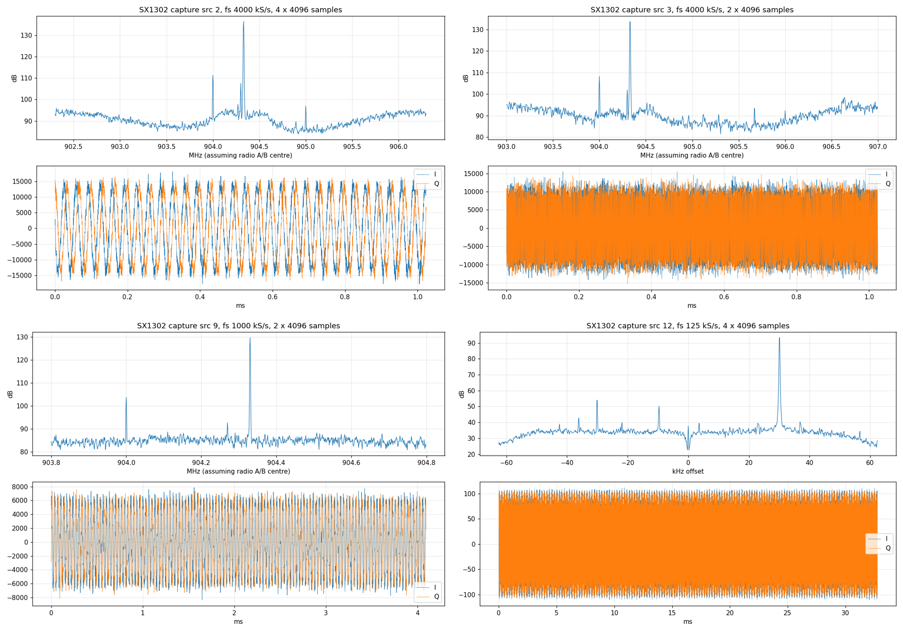

# SX1302-SDR

Raw I/Q from a Semtech SX1302 LoRa gateway chip on an ESP32-P4.

The SX1302 has a 16 KB capture RAM that its own HAL only uses for one-shot test dumps. SX1302-SDR runs that RAM as a ring buffer and reads it continuously over SPI, so a gateway module becomes a 125 kS/s receiver per channel, with 4 MS/s snapshots of each radio.

## Results

- Continuous 125 kS/s I/Q from any of the 8 LoRa channels, every sample delivered (10 s runs, 0 ring laps, 0 phase jumps at 16,132 SPI read boundaries).
- 4 MS/s 16-bit I/Q snapshots from each SX1250 radio, 4096 samples each.
- 1 MS/s snapshots from the radio A path.
- A CW test tone shows on both radios at the correct offset, 45 dB above the noise wideband and 60 dB in a 125 kHz channel.
- SPI reads bit-exact up to 20 MHz on jumper wires (the HAL uses 2 MHz).

<p align="center"></p>

## Hardware

- Waveshare ESP32-P4-NANO (P4 rev 3)
- Seeed WM1302 SPI module (SX1302 + 2x SX1250), US915 or EU868
- Heltec HT-HC01P debug board, used as a mini PCIe socket breakout
- 900 MHz antenna on the module's U.FL

## Wiring

The debug board's header is labelled for the Heltec HaLow card. With a WM1302 in the socket:

| Debug header | WM1302 signal | Nano |
| --- | --- | --- |
| 3V3 | 3V3 | 3V3 |
| GND | GND | GND |
| CLK | SPI_CLK | GPIO2 |
| MISO | SPI_MISO | GPIO3 |
| MOSI | SPI_MOSI | GPIO6 |
| CS | SX1302_CSN | GPIO53 |
| RESET | SX1302_RESET (active high) | GPIO23 |
| INT | SX1262_RESET (active low, held low) | GPIO22 |
| BUSY, WAKE | SX1262 DIO2, DIO1 | not used |

The SX1262 chip select is not on the header, so the firmware holds that chip in reset to keep it off MISO. The temperature sensor I2C is not on the header either; the firmware reports a fixed 25 C to the HAL. See [docs/wiring.md](docs/wiring.md).

## Build and flash

ESP-IDF 5.5 or newer, target esp32p4.

```
cd firmware/esp32p4
idf.py set-target esp32p4
idf.py build
idf.py -p PORT flash
```

On Windows, `build.ps1` and `build.ps1 -Flash -Port COM20` do the same with a standard `C:\Espressif` install.

## Console

UART0 at 115200. The firmware runs `lgw_start` at boot (radio A 904.3 MHz, radio B 905.0 MHz, 8 channels) and then takes commands:

| Command | Action |
| --- | --- |
| `sweep` | one capture from every source, with statistics |
| `cap <src> [b64]` | one capture; `b64` dumps the 16 KB as base64 |
| `ring <src> [polls] [us]` | wrap mode, prints the write pointer as it moves |
| `stream <src> [ms]` | continuous ring read, reports rate, laps and phase continuity |
| `tune <hz0> [hz1]` | restart with new radio frequencies |
| `spi <hz>` | change SPI clock, time a 16 KB read |
| `rd`, `wr`, `rdb` | raw register access |

## Tools

- `tools/sx1302_console.py PORT cmd [wait] ...` sends console commands.
- `tools/sx1302_grab.py PORT OUTDIR src[:count] ...` pulls captures, saves `.npy` and spectrum plots.

## How it works

See [docs/capture-ram.md](docs/capture-ram.md) for the capture sources, sample formats and the ring buffer.

## Limits

- Only channel taps (125 kS/s) stream continuously; 1 MS/s needs about 32 Mb/s of SPI reads.
- The module's SAW filters limit reception to its band (902 to 928 MHz on US915).
- The 8-bit channel taps clip on strong signals.
- SPI traffic couples into the receiver on jumper wires; keep the leads short.

## Credits

- [Semtech sx1302_hal](https://github.com/Lora-net/sx1302_hal) 2.1.0, in `firmware/esp32p4/components/libloragw` under its Revised BSD license. Its sources are unchanged; the ESP-IDF glue is in `shim/`.
- Seeed Studio WM1302 and Heltec HT-HC01P pinouts.
- [LR2021-SDR](https://github.com/SAMS0N1TE/lr2021-sdr), the sibling project for the LR2021.

## License

MIT, see [LICENSE](LICENSE). The Semtech HAL keeps its own license, see `firmware/esp32p4/components/libloragw/LICENSE.TXT`.
