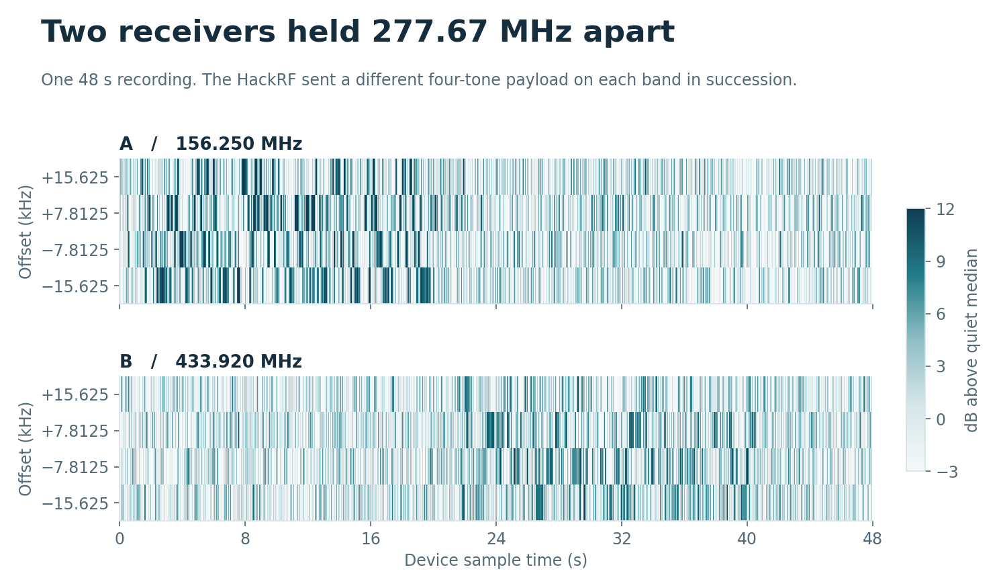
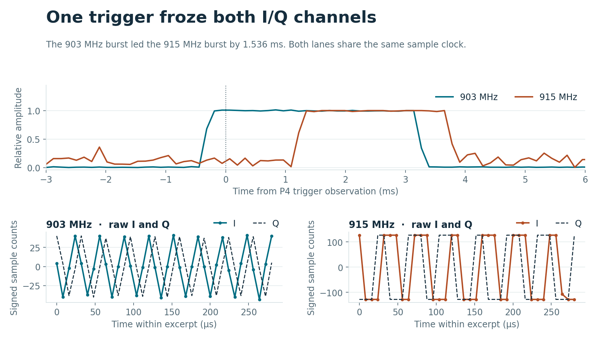
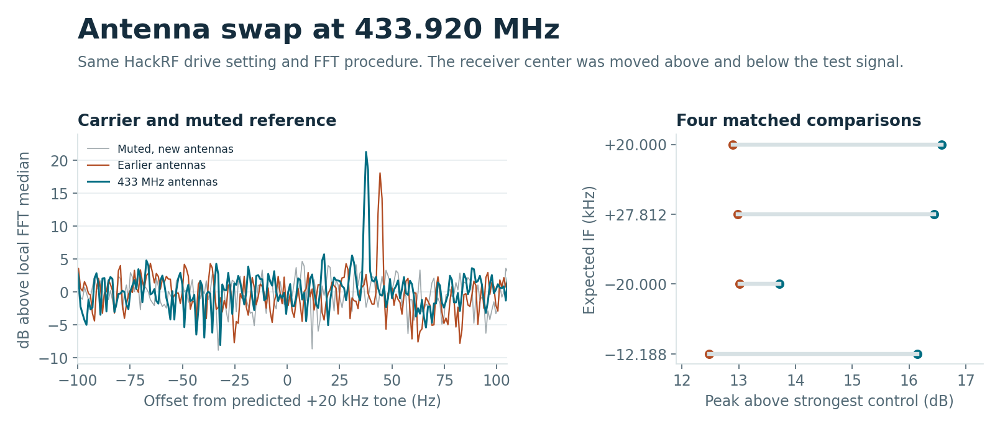
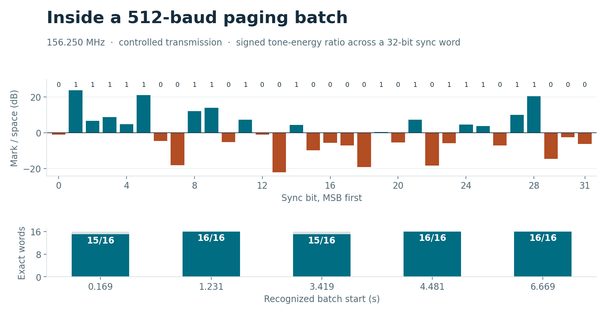

# Two radios across VHF and UHF

The US915 WM1302 decoded four distinct test frames at 156.250 MHz on radio A and four at 433.920 MHz on radio B during the same 48-second capture. Both receive chains stayed tuned. A single HackRF sent the two frame families in succession inside a shielded cage with VHF antennas on the two devices.

| Receiver | VHF frames passing CRC and payload check | UHF frames passing CRC and payload check |
| --- | ---: | ---: |
| A · 156.250 MHz signal | 4 | 0 |
| B · 433.920 MHz signal | 0 | 4 |

The synthesizers were set to 156.230 and 433.900 MHz, placing each signal at +20 kHz in its sampled IF. Each frame carried a sync word, a sequence byte, three deterministic payload bytes and CRC-16. Four-tone FSK sent two bits per symbol at 7.63 symbols/s, giving 15.26 raw bit/s. The HackRF TX VGA settings were 40 dB for VHF and 47 dB for UHF, with the RF amplifier disabled. These are transmitter settings. The received power in dBm is unknown.

The Nano delivered 5,978,435 of the device’s 5,999,986 pairs. It reported zero ring laps, 21 UART CRC errors on the host, and 6.198% previous-lap matches on the device. The figure uses the device sample timeline with missing USB data padded by zeros. Each row integrates one complex tone bin for about 82 ms and references its power to the median in a quiet portion of that lane. The four-bin research file preserves the complex phase needed to independently decode the payloads. [Data and verification commands](../research/dual-band/README.md)

## A trigger that keeps the leading edge

The AGC MCU watches two internal energy indications. It latches a channel after eight consecutive above-threshold observations. The P4 polls the latch and stops a 2,048-pair IF ring after a configurable delay. At 125 kS/s that gives 16.384 ms of simultaneous history. The host can retrieve the frozen I/Q after the burst ends.

The upper panel shows matched tone amplitude, normalized independently for each receiver. The lower panels show the same 36 sample instants directly from the recorder. Radio B reached the signed 8-bit limits in this strong-signal test. The dotted line marks when the P4 observed the latch. It includes polling latency.

The generator put bursts of 3.584 and 2.560 ms at 903 and 915 MHz, alternating which started first. The measured relative onset was +1.536, −1.536, +1.536 and −1.536 ms at 128 µs analysis resolution. Six separate 3 or 5 ms single-lane pulses triggered the expected lane. Both quiet controls timed out. The generator oscillator was already running before the modulated pulses began.

## Frequency coverage

Seeed rates this module for 902–928 MHz. At the lowest tested HackRF TX VGA setting, both lanes tracked both frequency shifts at the tested centers of 893, 895, 900, 902, 915, 928, 935, 940 and 942 MHz. The adjacent 892 and 944 MHz points failed that test. The sweep sampled discrete frequencies; there is no continuous sensitivity or passband measurement. At higher drive, the receiver also decoded 244 bit/s FSK test payloads at 780, 850 and 868.3 MHz. [All 42 frequency/drive combinations](../research/dual-band/data/frequency-sweep.csv) · [Seeed module specification](https://wiki.seeedstudio.com/WM1302_module/)

The stock HAL selects image calibration from a short list of frequency intervals. At 900 MHz it rejected startup before reception could be tested. The experimental `probetune` command separates calibration-table selection from the actual synthesizer setting. The VHF experiments used the 434 MHz table. Oscillator startup alone did not qualify as reception. [Semtech calibration code](https://github.com/Lora-net/sx1302_hal/blob/master/libloragw/src/loragw_sx1250.c)

### 433 MHz antenna repeat

Short snapshots failed the strict two-tone criterion even with 433 MHz antennas. Longer, contiguous FFT windows recovered the controlled carrier at two RX centers and two TX frequencies. Moving the receiver center from 433.900 to 433.940 MHz moved the 433.920 MHz carrier from +20,037.65 to −19,961.36 Hz. Across four matched trials, the median increase in peak-to-control margin over the earlier antennas was 3.56 dB. Antenna placement and cage coupling are included in that figure.

The spectrum panel uses 131,072-sample Hann windows. The right panel compares the peak with the **stronger** of two controls, a muted generator and the alternate tone. An earlier fixed-offset prediction failed after changing the oscillator configuration. A fresh fixed-tuning test identified all five commanded frequencies and both silent trials. With 433 MHz antennas, the 15.26 bit/s waveform yielded three distinct CRC-valid frames in a 19 s recording and zero in its muted control. [Paired measurements](../research/dual-band/data/antenna-433.csv)

## VHF paging waveform

With VHF antennas and the cage closed, moving the receiver center by 40 kHz moved a controlled 156.250000 MHz tone from +20,016.67 to −19,982.34 Hz. A second tone 7,812.5 Hz higher moved by the expected amount. At 40 dB TX VGA with the RF amplifier off, the slow four-tone test recovered three distinct CRC-checked frames. The 512-baud paging test at that drive yielded zero confirmed batches.

At 47 dB TX VGA with the HackRF TX RF amplifier enabled, the receiver recognized five batches from the synthetic 512-baud POCSAG transmission. After BCH correction, **78 of 80 words within those batches** exactly matched the transmitted words. Both muted controls yielded zero batches. The plot shows the expected sync bits above the measured tone-energy ratios. The lower panel counts exact words after timing selection and correction. These counts do not establish a field packet-error rate or calibrated sensitivity. [Controlled raw I/Q and decoder](../research/dual-band/README.md)

An open-cage check at **156.200 MHz** was a separate experiment. Neither the HackRF reference nor the WM1302 confirmed an off-air paging batch in simultaneous 45 s and 90 s listening windows, using 433 MHz and VHF antennas respectively. Without a reference burst those observations do not establish whether the WM1302 could receive that transmitter.
