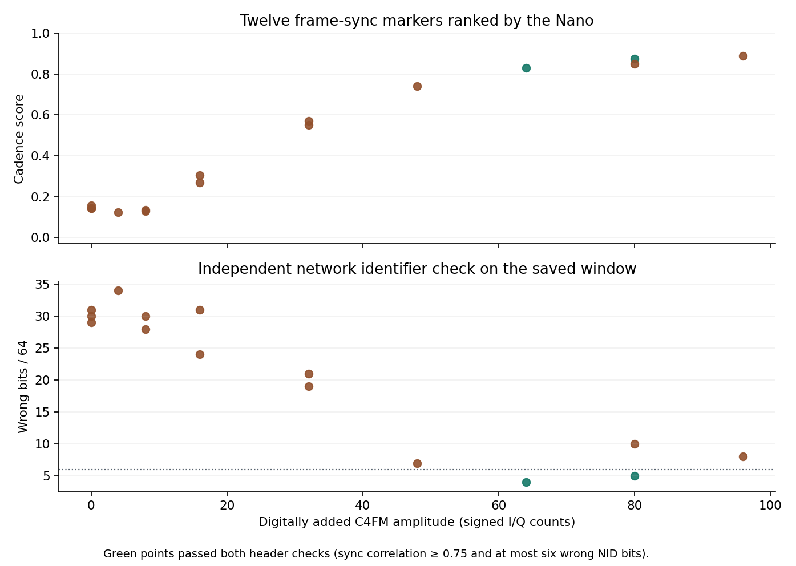

# P25 sync search on the P4 Nano

The P4 processes radio A I/Q and capture source 18 at 125 kS/s. It ranks repeated P25 Phase 1 frame-sync patterns and returns the strongest candidate from a timed scan. A quiet receiver also produces a winner. Supplying the expected 12-bit NAC adds a separate check of the following network identifier.

## Run a scan

Build and flash the ESP32-P4 probe using the main README. The host helper tunes both radios 20 kHz below the requested carrier and leaves them tuned there. Source 12 supplies the I/Q. The command below uses a carrier inside the US915 module's band.

~~~
python tools/sx1302_p25_scan.py COM3 --carrier-hz 915015625 --nac 0x293 --ms 20000 --out scan.npz
~~~

For experimental tuning outside the HAL calibration tables, add the appropriate bench `--cal-hz` value as described in [the frequency tests](dual-band-bench.md). The saved window contains chronological signed I/Q, source 18 byte 0 (radio A digital energy), stale flags, sample indices, scan score and any header-check result. The winning index marks the **end** of the 12-sync cadence check. A full 2,048-sample record includes 1,024 samples through that index and 1,024 following it. A scan ending soon after a new maximum can return a shorter tail. After a capture gap, the scorer waits for a fresh history.

## What the scores measure

The mixer removes the +20 kHz offset. A 49-tap fractional-phase FIR converts the signal to 24 kS/s. An imaginary lag-three complex product supplies a soft frequency discriminator. A normalized 120-sample correlation measures agreement with the 24-dibit P25 sync sequence. The P4 checks twelve successive 180 ms intervals at the same symbol phase, separately averages the even and odd repetitions, and ranks candidates on the weaker of the two averages using a common polarity. The scan needs nearly two seconds of recurring voice-frame syncs. Short calls and control-channel traffic may not satisfy that cadence.

The optional header check works on the saved window. It selects timing and polarity using sync alone, slices four frequency levels, skips the first status dibit, and compares the next 64 bits with the voice LDU1 and LDU2 NID codewords for the supplied NAC. The console prints the expected NAC, the nearer DUID, its bit distance, and sync correlation. `consistent=1` requires correlation of at least 0.75 and no more than six differing bits. These are bench criteria. The feature does not recover voice, identify an unknown NAC or assign a calibrated false-alarm probability. [Independent P25 framing implementation](https://github.com/balint256/op25/blob/master/op25/gr-op25_repeater/apps/tx/p25craft.py)

## Digital controls

`p25self` generates 12 sync patterns inside the P4 before the mixer and reports the winning sample index. `p25mix` adds a seeded C4FM test sequence to live radio A samples in software. It alternates LDU1/LDU2 network identifiers for NAC 0x293 with pseudorandom dibits elsewhere. The fixture is never transmitted over RF. The saved I/Q includes the digital addition; the energy byte still comes from the physical receiver. Amplitude is in signed sample counts and clipping is possible.

~~~
python tools/sx1302_p25_scan.py COM3 --carrier-hz 915015625 --ms 6000 --fixture-amplitude 64 --seed 81171 --out digital-control.npz
~~~

Each point represents a six-second run on one WM1302-SPI-US915 v1.1 in an open cage. All fifteen runs used the same VHF receiver setup. The stronger fixtures show when the P4 locates the repeated sync and when a single header verifies the expected NAC. For example, at 48 counts it found the expected end within two input samples and missed the header criterion by one bit. The quiet controls also return a peak. The chart contains aggregate digital control results. [Per-run measurements](../research/waveforms/data/p25-nano-controls.json) · [Reproduce the figure](../research/waveforms/nano_controls_figure.py)

A 20-second scan on this bench drained the capture ring at approximately 125 kS/s. Zero ring overruns and roughly six percent previous-lap matches were observed together. The latter are flagged in the returned window and blanked at the detector input.
