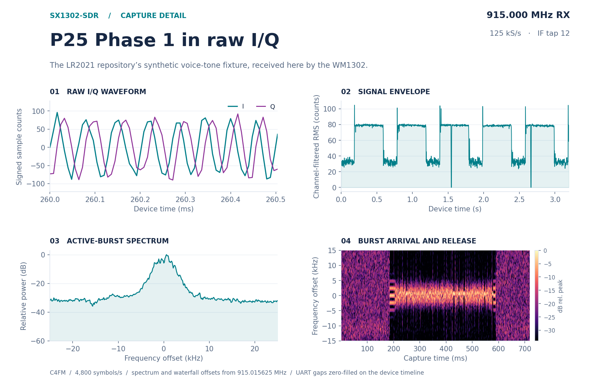
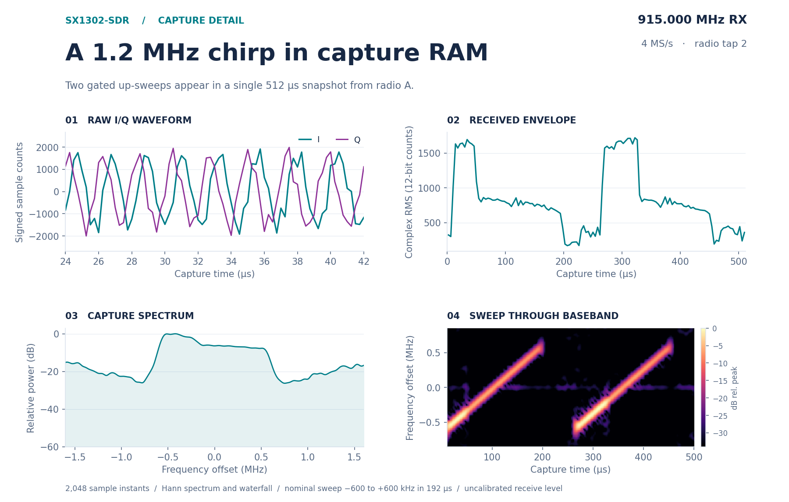
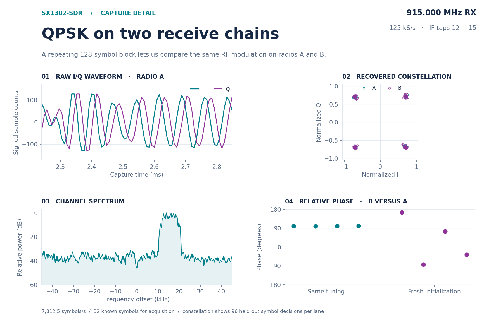

# Received I/Q waveform gallery

Three controlled signals went through a HackRF, the antenna path in a closed cage, both SX1250 radios and the SX1302 capture engine. The plots use received samples. The four-panel layout follows the [LR2021 capture detail](https://github.com/SAMS0N1TE/lr2021-sdr/blob/df251bf/docs/voice-capture.md). [Download the captures or reproduce the figures](../research/waveforms/README.md).

## P25 Phase 1 · same fixture, different receiver

The transmitter replayed the LR2021 project's published, synthetic 1,011 Hz voice-test sequence at **915.015625 MHz**. Each repetition consisted of 405 ms of C4FM followed by 195 ms of quiet. The two SX1302 IF channels recorded concurrently for 3.2 s. In the spectrum and waterfall, zero frequency is the test carrier. The amplitude variation during quiet includes receiver noise and gain changes.

Stock DSD-neo recovered NAC `0x293`, LDU1, LDU2 and TDU from **each** raw lane. The following numbers distinguish individual receptions from processing repeated data.

| DSD input | IMBE words reported | Check against LR reference | Irrecoverable header errors |
| --- | ---: | --- | ---: |
| A, individual transmissions | 36 | 16 matched a reference word value | 3 |
| B, individual transmissions | 36 | 17 matched a reference word value | 4 |
| A, five repetitions combined | 18 | All 18 matched in order | 0 |
| B, five repetitions combined | 18 | All 18 matched in order | 0 |

The combined result uses five complete, identical 600 ms periods from **one lane at a time**. The frontend averages the instantaneous frequency at matching times, giving no weight to missing UART samples, flagged stale runs and their filter transients. The decoder receives discriminator audio without expected bits or identifiers. Folding is applicable here because the transmitted test sequence repeats. The raw stream had two UART CRC errors, zero device ring overruns and about 6.6% flagged samples.

The vocoder output from lane A lasts 0.360 s. Its largest audio FFT bin is 1,011.1 Hz. [Recovered synthetic test tone (WAV)](../research/waveforms/data/recovered-test-tone.wav) · [LR2021 transmit fixture and provenance](https://github.com/SAMS0N1TE/lr2021-sdr/tree/df251bf/research/tx-p25)

## A wide chirp · 4 MS/s capture RAM

A linear sweep traversed **−600 to +600 kHz in 192 µs**, repeating every 256 µs. A paired 2k × 64 one-shot captured 512 µs from sources 2 and 3. The figure uses radio A. Its measured ridge slope through the interior of the sweep was **6.26 kHz/µs**, against 6.25 programmed. The median ridge error was 1.56 kHz with signal present and 217 kHz with the DAC muted. The waterfall uses 96-sample Hann windows with 512-point FFT interpolation. The differing amplitudes on either side of center are visible in the received samples. This sweep establishes tracking across the captured span; absolute gain and flatness were not calibrated.

## QPSK · timing, constellation and phase

The transmitter sent a periodic 128-symbol QPSK block at 7,812.5 symbols/s, offset +15.625 kHz from both receiver centers. The first 32 symbols established timing, carrier offset and a complex gain on each lane. The remaining 96 symbols supplied the constellation and error measurements.

| Capture | A · wrong symbols / 96 | B · wrong symbols / 96 | A / B RMS EVM |
| --- | ---: | ---: | ---: |
| Signal | 0 | 0 | 2.93% / 4.22% |
| Muted control | 68 | 70 | 218% / 242% |

The strong capture put about 8.1% of its signed IF component values on a rail. EVM describes the matched-filtered symbol decisions under those conditions. It does not establish receiver dynamic range.

**Phase held within one tuning and changed after reinitialization.** With the same stimulus on both radios, four independent snapshots at one tuning gave B-minus-A phase from **99.50° to 100.65°**. Four full `tune` restarts at the same center frequency gave **165.90°, −84.31°, 74.52° and −37.64°**. Feeding the same IF source into both capture lanes gave identical words and 0°. The measurement is the argument of the complex cross-product over a snapshot. It includes the receiver paths and shared input. An application that needs absolute phase would have to calibrate after initialization. Angle of arrival, long-term phase stability and independent antenna inputs were not tested.
